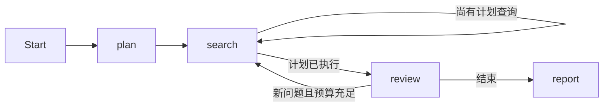

# Evidence Research

一个用 LangGraph 编排的中文深度研究助手。输入研究问题后，模型拆分检索任务，读取 Tavily 返回的来源摘要，提出带逐字摘录的结论。每次运行可保存 Markdown 报告和各节点的 JSON 执行记录。

## 快速体验

在 Python 3.11 或 3.12 环境中，从仓库根目录执行：

```sh
python -m pip install -r requirements.txt
python research.py --demo --output report.md --trace trace.json
python -m unittest -v
```

演示使用固定的虚构缓存实验数据，执行真实的 LangGraph 工作流。两次搜索分别返回基线记录和复测记录。加上 `--budget 1` 可以观察补充检索被预算截断后的报告。

## 研究任意主题

设置 `TAVILY_API_KEY`、`LLM_API_KEY`、`LLM_MODEL` 和 `LLM_BASE_URL`。模型服务需支持 Chat Completions 和 JSON 文本输出，基础地址需包含服务要求的 API 版本前缀，例如 `https://api.openai.com/v1`。运行时会将检索词发送给 Tavily，将主题和搜索摘要发送给所选模型。

```sh
python research.py "LangGraph 中断恢复依赖哪些状态？" --budget 4 --output report.md --trace trace.json
```

## 图与证据校验



- **plan** 生成最多三个初始查询，按输入预算截短。
- **search** 每次执行一个查询，按 URL 去重并给来源分配稳定编号。单次最多取四条摘要，每条截取前 3200 个字符。
- **review** 综合当前全部摘要。程序逐条检查来源编号与逐字摘录，保留通过检查的结论。模型可提出补充查询，总查询预算为 1 至 8。
- **report** 将通过检查的结论、摘录和链接写入 Markdown，无合格结论时报告资料不足。逐字匹配能检查摘录出处，语义支持程度与来源可信度仍需阅读原文判断。

节点完成后会向终端输出节点名。网络失败或模型输出格式有误时，命令以非零状态退出，指定的 trace 文件会保留已经完成的步骤。

## 项目来源

研究流程参考 Datawhale《Hello-Agents》第十四章的任务规划、检索、总结和报告设计。本仓库独立编写 Python 实现，使用 LangGraph 条件边控制补查，以逐字摘录和来源编号校验报告。当前交互入口为命令行。[参考项目](https://github.com/datawhalechina/hello-agents/tree/main/code/chapter14/helloagents-deepresearch) · [LangGraph 文档](https://docs.langchain.com/oss/python/langgraph/overview)

